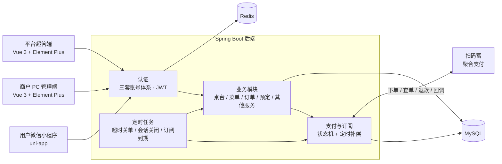

# 厨师不忙 · 餐饮商户多端预订与点餐 SaaS

> 面向餐饮商户的多端 SaaS 系统，覆盖扫码点餐、餐桌预订、上门餐饮服务、商户经营管理与平台订阅运营。
>
> A multi-tenant restaurant SaaS: QR-code ordering, table reservations, catering services, merchant back office and platform subscription management.

> 本项目为实习期间开发的商业产品，源代码归所属公司所有。本仓库只展示本人负责部分的产品设计、系统架构与关键实现思路，不包含源代码、接口密钥或内部文档。

---

## 我的角色

**开发工程师（实习，兼需求对接与测试）**，2026.01 – 2026.05

- 将业务方口述的需求整理成完整需求文档，发现并推动修正 4 处业务逻辑冲突，推动 3 个悬置问题明确后再开发。
- 4 个半月独立完成后端、微信小程序、商户 PC 管理端与平台超管端四端开发，接入真实支付通道并完成部署。

---

## 系统组成

| 端 | 使用者 | 主要功能 |
|---|---|---|
| **用户微信小程序** | 顾客 | 扫码点餐与多轮加菜、餐厅预订（可选提前点餐）、送餐服务与整队上门服务、历史订单、我的预定、服务查询 |
| **商户 PC 管理端** | 餐厅 | 实时桌台看板、菜单（分类 / 菜品 / 套餐）、订单、大厅与包厢管理、预定处理、其他服务、营业参数配置、统计概览、订阅管理 |
| **平台超管端** | 平台运营 | 平台概览、商户审核与启用 / 禁用、订阅方案与手动延期、推荐体系、平台参数设置 |
| **后端服务** | — | 12 个业务模块：认证、桌台、菜单、订单、预定、其他服务、支付、订阅与平台管理、推荐、商户设置、统计、厨房排程 |

---

## 技术栈

| 层 | 技术 |
|---|---|
| 后端 | Java 17、Spring Boot 3.2、MyBatis、MySQL、Redis、JWT、BCrypt |
| 用户端 | uni-app（Vue 3）+ Pinia，微信小程序 |
| 商户端 / 超管端 | Vue 3、Element Plus、Pinia、Vite |
| 支付 | 扫码富聚合支付（微信 JSAPI 支付） |
| 测试 | JUnit 单元测试（11 个测试类，覆盖认证、下单、预定、支付、签名加解密、订阅） |

---

## 系统架构

---

## 关键设计

### 1. 桌台状态与“桌台会话”
- 桌台四色状态：🟢 空闲 → 🟠 用餐中（未结账）→ 🔴 已结账 → ⚪ 待清台；🟡 预定角标可叠加在任何颜色上。
- 引入“桌台会话”：同一桌多人扫码加入同一会话，共享账单、支持多轮加菜；提供强制翻台和预定缓冲（离预定时间过近时拒绝入座）。
- 解决了扫码点餐场景下桌台状态与订单状态不一致的问题。

### 2. 预定规则
- 大厅预定在商户接受后自动分配桌位（人数小于等于座位数），包厢预定由商户手动分配。
- 每张桌台每个时段（午餐 / 晚餐）只接受一次预定；商户 15 分钟未处理时自动处理。
- 取消规则：用餐前 24 小时以外取消可全额退款，24 小时以内不退款，退款原路返回。

### 3. 支付可靠性
- 对接扫码富聚合支付：请求明文参与 SHA256 签名，DES 加密后发送；响应先解密，再验签。
- 支付记录状态机：`pending → success / fail / closed`，成功后可退款至 `refunded`；退款记录另有独立状态机。
- 双通道确认：小程序端轮询支付结果 + 服务端接收异步回调。
- **定时补偿任务**：保证即使支付回调丢失，订单与支付状态也能最终一致。

| 任务 | 频率 | 逻辑 |
|---|---|---|
| 支付补偿 | 每 2 分钟 | 查询超过 5 分钟仍为 pending 的记录，主动向支付平台查询真实状态 |
| 退款补偿 | 每 5 分钟 | 主动查询 pending 退款的结果 |
| 超时关单 | 每 10 分钟 | 关闭超过 30 分钟未支付的订单，并按业务类型取消本地预备单 |
| 会话自动关闭 | 每 5 分钟 | 已全部付款且空闲超过 30 分钟的会话自动关闭，桌台转为待清台 |

### 4. 订阅与推荐（商业模式）
- 新商户注册后享受 1 个月免费试用，到期后付费续订。
- **软降级**策略，不直接封号：到期前 7 天弹窗提醒，前 3 天显示倒计时横幅；到期后仍可登录、查看历史数据，但不能新建订单和预定；数据至少保留 30 天。
- 推荐奖励：以推荐链接为主、推荐码为备用；新商户**首次付费后**，推荐人自动获得 1 个月使用期，奖励可叠加；同一新商户只能绑定一个推荐人。

### 5. 可配置的商户营业参数
- 是否要求预定时提前点餐、锁位费（仅包厢）、包厢最低消费、其他服务的服务费比例、营业时间、订单超时时间（10 – 120 分钟）、预定缓冲时长等，均由商户在综合管理页自行配置。

---

## 数据模型（20 余张表）

| 领域 | 主要表 |
|---|---|
| 账号 | `user`、`merchant`、`admin_user` |
| 桌台 | `hall_table`、`private_room`、`room_image`、`table_session` |
| 菜单 | `menu_category`、`dish`、`package_set`、`package_dish` |
| 订单与预定 | `order`、`order_item`、`reservation`、`business_hour` |
| 其他服务 | `extra_service`、`catering_draft` |
| 支付与订阅 | `payment_record`、`refund_record`、`subscription_plan`、`subscription_log` |
| 平台 | `platform_setting`、`referral_record`、`admin_notification` |
| 厨房 | `kitchen_schedule`、`dish_time_estimate`、`kitchen_cook_log` |
